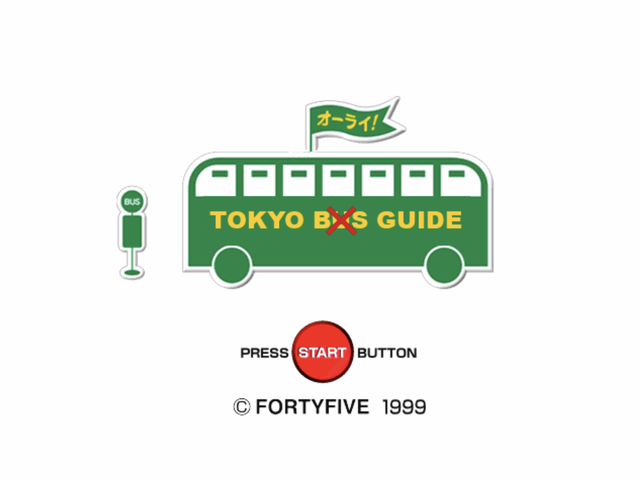
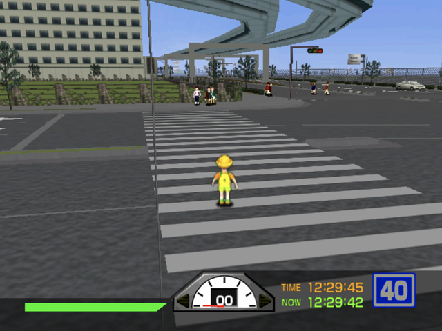
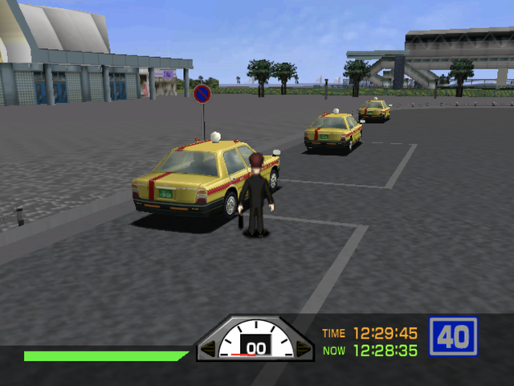
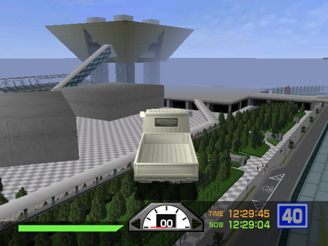
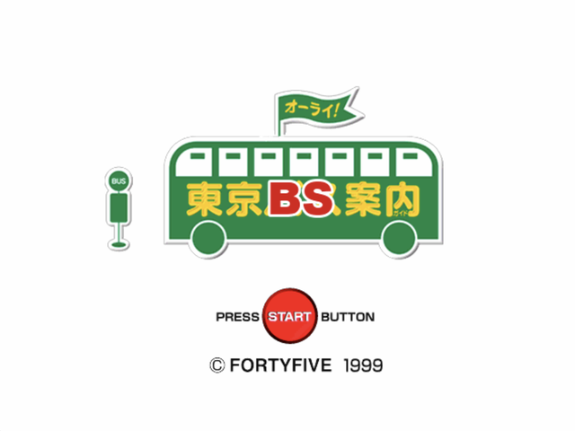

# Tokyo Bus Guide (Japan): Tokyo BS Guide

A sandbox mod for the Dreamcast game *Tokyo Bus Guide* (東京バス案内, Fortyfive, 1999): get off
the bus and walk as one of the game's own pedestrians, take any traffic car or parked taxi, and
drive around Tokyo with the route rules switched off.

   

The Japanese build keeps the game's own logo, with the same joke: 

## Download

**Latest release:** [Tokyo BS Guide v1.1](https://github.com/consolesplayingconsoles/game-mods/releases/tag/tokyo-bus-guide-japan-tokyo-bs-guide-v1.1)

Two builds, same mod:

* [`Tokyo Bus Guide (Japan) [Tokyo BS Guide by cpc v1.1].dcp`](https://github.com/consolesplayingconsoles/game-mods/releases/download/tokyo-bus-guide-japan-tokyo-bs-guide-v1.1/Tokyo.Bus.Guide.Japan.Tokyo.BS.Guide.by.cpc.v1.1.dcp): English (translation v1.1.2).
* [`Tokyo Bus Guide (Japan) [Tokyo BS Guide JP by cpc v1.1].dcp`](https://github.com/consolesplayingconsoles/game-mods/releases/download/tokyo-bus-guide-japan-tokyo-bs-guide-v1.1/Tokyo.Bus.Guide.Japan.Tokyo.BS.Guide.JP.by.cpc.v1.1.dcp): Japanese.

Releases in this monorepo are namespaced per game, so the tag carries the game name
(`tokyo-bus-guide-japan-...`), not just a version.

## What it does

* Step off the bus at the door: you become one of the game's own pedestrian sprites and the
  camera follows you. The bus stays where you left it.
* Take any traffic car or parked taxi. The traffic AI gives up the one you steal.
* Horn (each model gets one of the game's six traffic horns), radio through the game's own bgm
  tracks, handbrake, turbo burst, and a ghost mode that lets a car fly.
* Penalties never lower the score, and are off entirely while you are out of the bus. That is
  the key to the whole thing: the levels turn out to be small and pleasant once traffic
  penalties stop throwing you out of them.
* Ride trains, the Yurikamome and the Ferris wheel, and fly them.
* Fly a helicopter and a Boeing 747.
* Drop cars out of the 747.
* Skydive: jump out mid-air, land on car roofs or the 747's back, jump from car to car, or grab
  a falling car and drive it.
* Board the plane or the helicopter in mid-air.
* All courses unlocked.

## Where to find the rides

* **Ome:** helicopter and Boeing 747, anywhere on the route.
* **Shinjuku:** trains, near the end of the route.
* **Wangan:** Ferris wheel and Yurikamome in the first half, Boeing 747 mid-route (day and
  evening).

## Controls

| Button | On foot | In a car | Riding or flying |
|---|---|---|---|
| Stick | walk | steer, height in ghost mode | steer, climb, turn the wheel |
| R | sprint | accelerate | forward |
| L | | brake, reverse | back |
| A | jump, double jump | horn | drop a car, spin the wheel |
| B | | handbrake | brake |
| X | | radio | radio |
| Y | | turbo | turbo |
| D-pad Up | | ghost mode | fly a train or the wheel |
| D-pad Down | change pedestrian | | |
| D-pad Left | next ride | | next ride |
| D-pad Right | get on or in | get out | jump out |

On the bus everything is the original game, plus D-pad Right to get off.

## Applying the patch

Use [Universal Dreamcast Patcher](https://github.com/DerekPascarella/UniversalDreamcastPatcher).
It rebuilds a disc image from your own copy of the game, so GDI, CUE+BIN and CHD all work, and
it can output a GDI for a GDEMU.

You need **Tokyo Bus Guide (Japan), V1.003** (the 1999-11-24 pressing). The later **Rev A
(V2.000)** is a different disc and the patch does not apply to it.

```
Tokyo Bus Guide (Japan).gdi   CRC32 468C1495   MD5 346FEA58AB1A55C577138C5B04319157
track01.bin                   CRC32 CA1BA208   MD5 7B2D900981E0B7B87EBF9312FD206098
track02.raw                   CRC32 2FFBCC4C   MD5 9078A058A0CEBD448243935A693B4D0E
track03.bin                   CRC32 38FC999F   MD5 5FA322A0642CA5352EF733842148AFE7
```

1. Open the **Apply Patch** tab.
2. Select your source disc image.
3. Choose the `.dcp` file.
4. Pick an output folder and format (GDI if you are going to a GDEMU).
5. Apply.

Runs on a real Dreamcast (tested through a GDEMU) and in Flycast.

## Known gaps

* **No building collision.** The game has none: the route grids are the route, not the world.
  The player, the cars and the bus collide with each other as boxes; buildings are scenery you
  walk and drive through.
* **Flat ground on foot.** Ramps and bridges do not lift you.
* **AI cars and dropped cars pass through each other.** Only the car you drive collides.
* **Off-route scenery is thin.** Once penalties are gone you notice how little was built away
  from the route: a flat sea, placeholder ground, a few trees. It only ever had to look right
  from the bus.

## How it was made

Built by rebuilding the game from
[lhsazevedo's Tokyo Bus Guide decompilation](https://github.com/lhsazevedo/tokyo-bus-guide-decomp),
the first public decompilation of a Dreamcast game, rather than patching bytes. Source, build
scripts and the mod's tunables (speeds, box sizes, sprint) live in
[dreamcast-homebrew](https://github.com/consolesplayingconsoles/dreamcast-homebrew/tree/main/mods/tokyo-bus-guide).

## Feedback

Found a bug or have an idea for what the sandbox should do next?
[Open an issue](https://github.com/consolesplayingconsoles/game-mods/issues/new).
