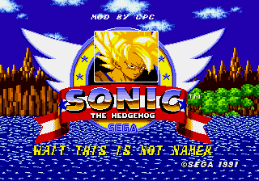
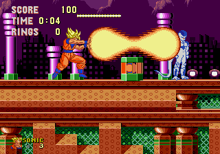
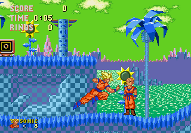
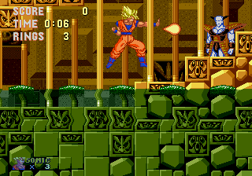

# Sonic the Hedgehog (USA, Europe): Wait, this is not Namek

**Goku** in the Mega Drive game *Sonic the Hedgehog*: he runs, flies and fights through every
zone with his Dragon Ball Z moves, against DBZ fighters in place of the badniks and **Buzz
Lightyear** in place of Robotnik.

   

See it in action on Instagram: [part 1](https://www.instagram.com/p/DeDCIuTx9-_/), [part 2](https://www.instagram.com/p/DeHyDm0xMuv/), [part 3](https://www.instagram.com/p/DePnNYOxsFn/).

## Download

**Latest release:** [Wait, this is not Namek v0.8](https://github.com/consolesplayingconsoles/game-mods/releases/tag/sonic-the-hedgehog-usa-eu-wait-this-is-not-namek-v0.8)

Two files:

* `Sonic The Hedgehog [Wait, this is not Namek by cpc v0.8].bps`: the patch.
* `Sonic The Hedgehog [Wait, this is not Namek by cpc v0.8].html`: the patcher.

Releases in this monorepo are namespaced per game, so the tag carries the game name
(`sonic-the-hedgehog-usa-eu-...`), not just a version.

## What it does

* Goku replaces Sonic, with his Dragon Ball Z moves: punches, kicks, guard, flight and five
  special moves.
* The badniks are DBZ fighters: Krillin, Vegeta, Frieza, Gohan, Trunks, Ginyu, Recoome,
  Cell and the androids.
* Buzz Lightyear is the boss, Eggmobile included, up to the Final Zone.
* Krillin plays the special stages.
* Invincibility is Super Saiyan.
* Walls and blocks Sonic broke by spinning break under Goku's attacks.
* The end: Goku finishes Buzz off with a Kamehameha, then the credits.

## Controls

| Button | Action |
|---|---|
| C | jump |
| A | punch |
| B | kick |
| Down | guard |
| C + Up | fly up |
| C + Down | fly down |
| Start | pause, with the special moves list |

| Special move | Input (facing right) |
|---|---|
| Kamehameha | → ↓ ← A |
| Energy blast | ← → A |
| Dash elbow | ↓ ← A |
| Jump knee lift | ↓ ↑ B |
| Flurry kick | ← ↓ → B |

No Kamehameha during boss fights.

## Applying the patch

Use the patcher from the release: open the `.html` file in your browser (it works offline),
drop the patch and the three games in their boxes, and press **Make the ROM**. Zipped files are
fine. Everything happens in your browser: nothing is uploaded.

Do not use rom-patcher-js or Flips. The parts that come from Dragon Ball Z and Toy Story are not
in the patch: the patcher makes them from your own copies of those games. Other patchers apply
the file but give a broken ROM.

You need your own copy of all three games, exactly these dumps (each box only takes an exact
match):

```
Sonic the Hedgehog (USA, Europe)            CRC32 F9394E97   SHA-1 6DDB7DE1E17E7F6CDB88927BD906352030DAA194
Dragon Ball Z - L'Appel du Destin (France)  CRC32 F035C737   SHA-1 5FF71986F4911B5DFD16598A5A3A9BA398C92C60
Toy Story (USA)                             CRC32 829FE313   SHA-1 49BE571CD943FD594949C318A0BDBE6263FDD512
```

Load the ROM in a Mega Drive emulator, or flash it to a cart: it runs on real hardware.

## Known gaps

* No Kamehameha during boss fights: the beam and a boss don't fit on the Mega Drive's sprite
  lines together.

## Feedback

Found a bug? [Open an issue](https://github.com/consolesplayingconsoles/game-mods/issues/new).
Note the zone and act (a screenshot helps), and mention that it is the Wait, this is not Namek
mod.
